<div align="center">

# 🌱 Plant Disease Detection

### A Comparative Study of Plant Disease Detection Using Machine Learning & Deep Learning

*Can a computer tell a healthy leaf from a diseased one, and which kind of model does it best?*

**ResNet50 · Custom CNN · Random Forest · AdaBoost · KNN** on the PlantVillage dataset (38 classes)

<br>

<a href="https://plant-disease-detection-dusky.vercel.app">
  
</a>

<br><br>

[](website/paper.pdf)
[](CSE427%20project%20(8).ipynb)
[](#-performance-comparison)


</div>

---

## 🌐 Live Project Website

<div align="center">

### 👉 [**plant-disease-detection-dusky.vercel.app**](https://plant-disease-detection-dusky.vercel.app) 👈

<a href="https://plant-disease-detection-dusky.vercel.app">
  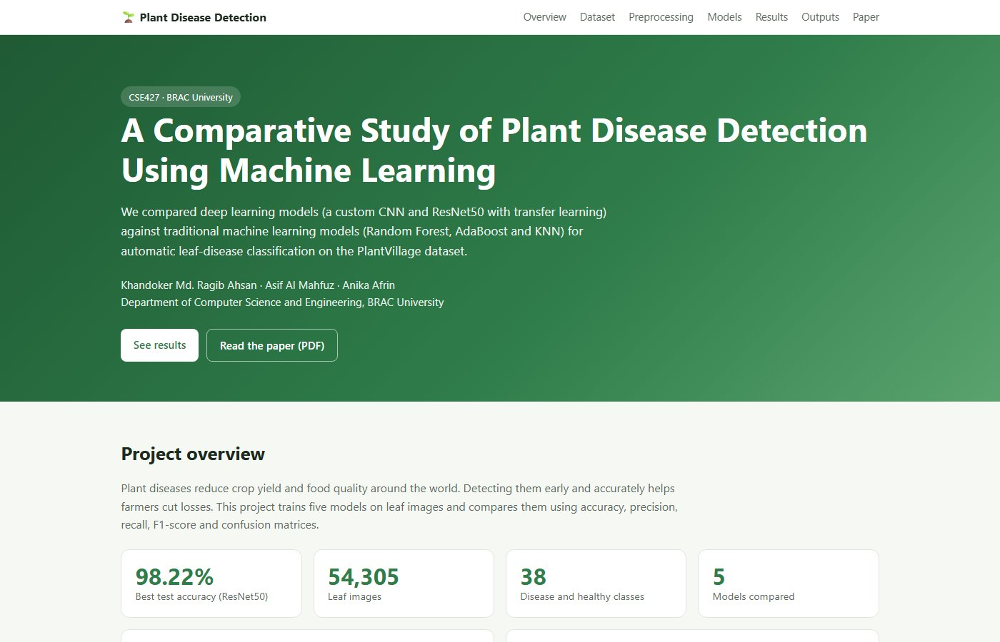
</a>

<sub>Click the image to open the website</sub>

</div>

The website walks through the full project on a single page:

| Section | What you'll see |
|---|---|
| 📌 **Overview** | Problem statement, objectives and key numbers |
| 📂 **Dataset** | PlantVillage splits and sample leaf images |
| ⚙️ **Preprocessing** | Every augmentation technique, shown visually |
| 🤖 **Models** | All five models and how they're built |
| 📊 **Results** | Accuracy table, comparison charts, training curves |
| 🖼️ **Outputs** | Confusion matrices, ROC curves, metric charts (click any image to zoom in) |
| 📄 **Paper** | The full research paper, readable in the browser |

---

## 📋 Table of Contents

- [Key Results](#-key-results)
- [Project Overview](#-project-overview)
- [Methodology](#-methodology)
- [Dataset](#-dataset-plantvillage)
- [Data Preprocessing & Augmentation](#️-data-preprocessing--augmentation)
- [Models Used](#-models-used)
- [Performance Comparison](#-performance-comparison)
- [Discussion](#-discussion)
- [How to Run](#-how-to-run)
- [Repository Structure](#-repository-structure)
- [Research Paper & Authors](#-research-paper)

---

## ✨ Key Results

<div align="center">

| 🏆 Best accuracy | 🖼️ Images | 🏷️ Classes | 🌾 Crops | 🤖 Models |
|:---:|:---:|:---:|:---:|:---:|
| **98.22%** | **54,305** | **38** | **14** | **5** |
| ResNet50 | PlantVillage | diseased + healthy | species | compared |

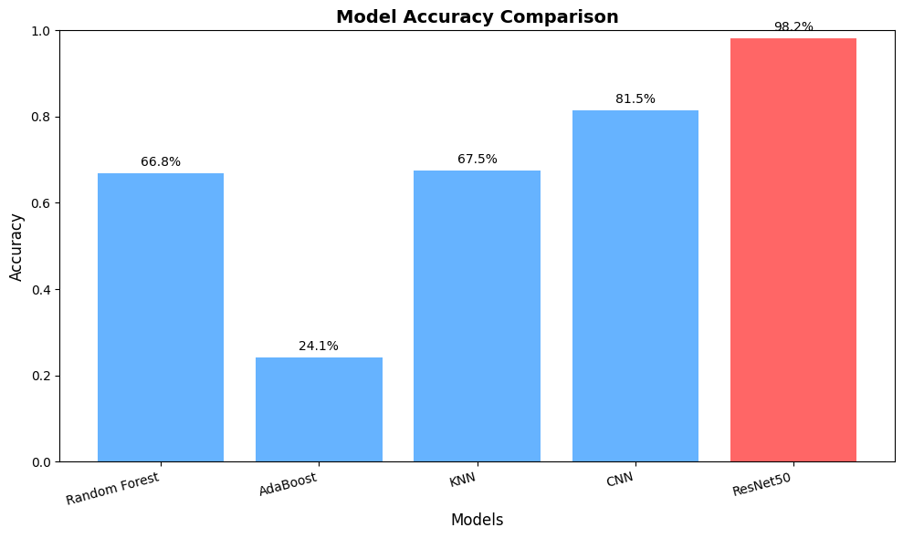

</div>

---

## 📌 Project Overview

Plant diseases are one of the biggest threats to food security. They cut crop yield, lower food quality and cost farmers a large share of their income every season. Checking leaves by eye takes expert knowledge and time, and by the time symptoms are obvious the disease has often already spread.

This project asks a simple question: **given a photo of a leaf, can a model identify the crop and its disease automatically, and which family of models does it best?**

To answer it, we trained and compared five models from two families:

- **Deep learning:** a custom Convolutional Neural Network (CNN) trained from scratch, and **ResNet50** with transfer learning from ImageNet
- **Traditional machine learning:** Random Forest, AdaBoost and K-Nearest Neighbors (KNN), working on PCA-compressed pixel features

All models use the same train/validation/test split of the PlantVillage dataset, so the comparison is fair. They are evaluated with accuracy, precision, recall, F1-score and confusion matrices.

### 🎯 Objectives

- ✅ Detect plant diseases automatically from leaf images
- ✅ Compare traditional ML algorithms against deep learning models
- ✅ Analyse each model with standard evaluation metrics
- ✅ Identify the most reliable model for practical, real-world use

---

## 🔬 Methodology

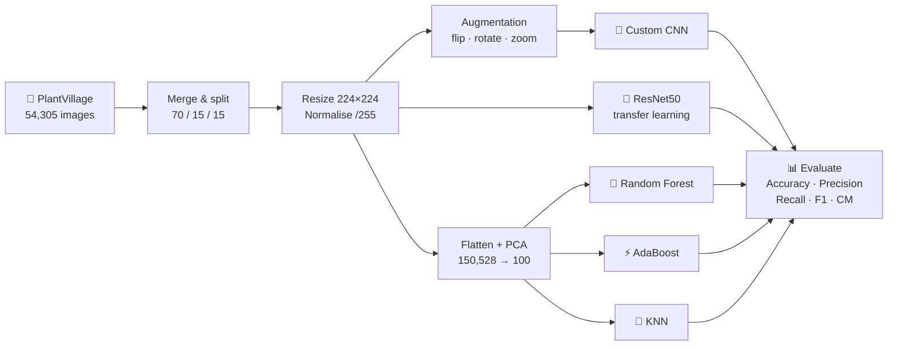

1. **Data preparation:** the original PlantVillage folders are merged and split per class into train (70%), validation (15%) and test (15%) with a fixed random seed (42), so the split is reproducible.
2. **Preprocessing:** all images are resized to 224 × 224 × 3 and normalised to the [0, 1] range.
3. **Two feature paths:**
   - *Deep models* learn features directly from the image pixels, with on-the-fly augmentation for the CNN.
   - *Classic ML models* can't handle 150,528 raw pixel values well, so each image is flattened and compressed with **PCA to 100 features**, which still keep 79.14% of the variance.
4. **Training:** the CNN and ResNet50 train for 10 epochs on an NVIDIA RTX 3070 Ti GPU. The ML models are trained with scikit-learn.
5. **Evaluation:** every model is scored on the same held-out test set of 8,162 images.

---

## 📂 Dataset: PlantVillage

PlantVillage is a public dataset of leaf images taken under controlled conditions. Each image is labelled with the crop species and either a specific disease or "healthy".

| Property | Value |
|---|---|
| Total images | **54,305** |
| Classes | **38** (crop × disease combinations, including healthy) |
| Crop species | **14** |
| Disease types | Bacterial, viral, fungal/mould and mite-related |

**Crops covered:** 🍎 Apple · 🫐 Blueberry · 🍒 Cherry · 🌽 Corn (maize) · 🍇 Grape · 🍊 Orange · 🍑 Peach · 🫑 Bell pepper · 🥔 Potato · Raspberry · Soybean · Squash · 🍓 Strawberry · 🍅 Tomato

**Example classes:** `Tomato___Late_blight`, `Potato___Early_blight`, `Apple___Black_rot`, `Grape___Esca_(Black_Measles)`, `Orange___Haunglongbing_(Citrus_greening)`, `Squash___Powdery_mildew`, `Tomato___Tomato_Yellow_Leaf_Curl_Virus` and healthy classes for each crop.

### Dataset split

| Split | Share | Images | Purpose |
|---|:---:|---:|---|
| 🟢 Training | 70% | 37,997 | Learn model parameters |
| 🟡 Validation | 15% | 8,146 | Tune and monitor during training |
| 🔴 Testing | 15% | 8,162 | Final, unbiased evaluation |

<p align="center">
  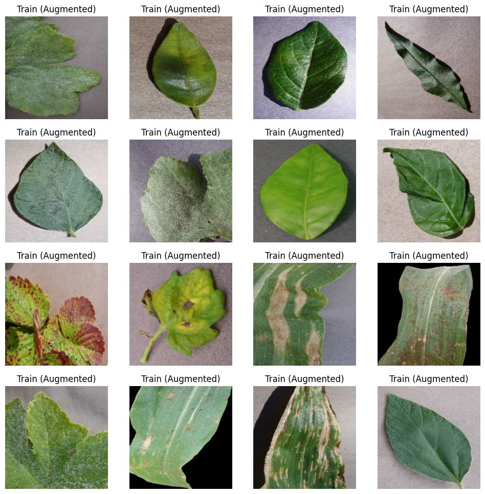
  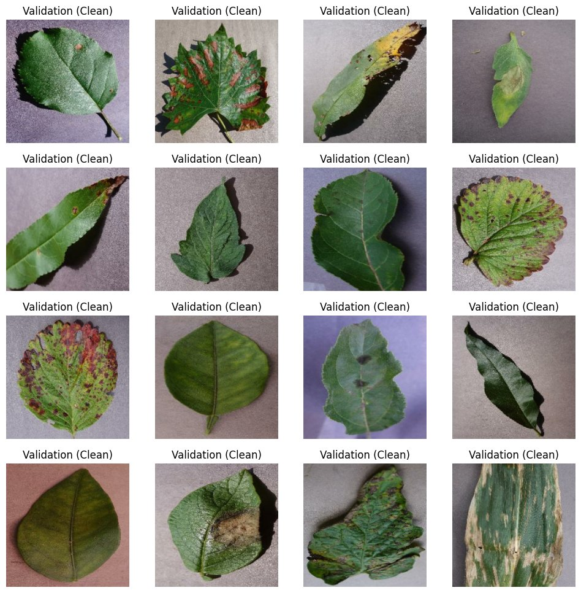
  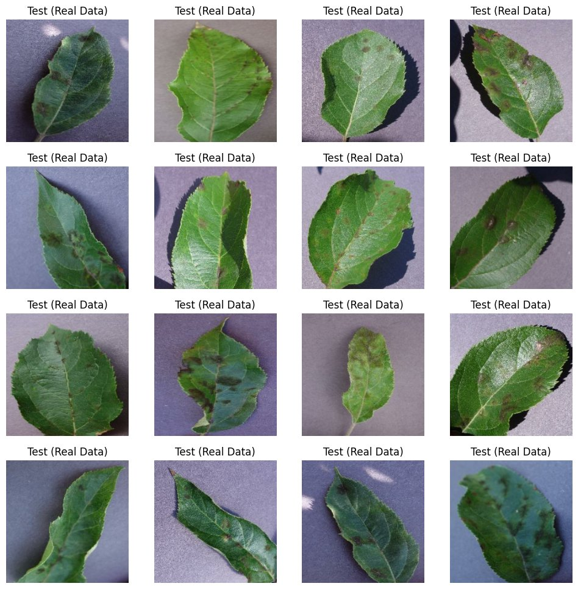
  <br><em>Training (augmented) · Validation (clean) · Test (real data)</em>
</p>

---

## ⚙️ Data Preprocessing & Augmentation

### Preprocessing

| Step | Details | Applied to |
|---|---|---|
| Resizing | 224 × 224 × 3 | All models |
| Normalisation | Pixel values ÷ 255 → [0, 1] | All models |
| Flattening + PCA | 150,528 → 100 features (79.14% variance kept) | Random Forest, AdaBoost, KNN |

### Augmentation

Augmentation creates slightly changed copies of the training images. The model sees more variety, which reduces overfitting and helps it cope with real-world photos taken from different angles and in different lighting.

| Technique | Effect |
|---|---|
| ↔️ Horizontal flip | Mirrors the leaf left-to-right |
| 🔄 Random rotation (±20%) | Simulates different camera angles |
| 🔍 Random zoom (±20%) | Simulates different distances |
| ✂️ Random crop | Focuses on part of the leaf |
| 🌫️ Gaussian noise | Simulates low-quality or noisy cameras |
| 🎨 Colour channel flip | Makes the model less sensitive to colour shifts |

<p align="center">
  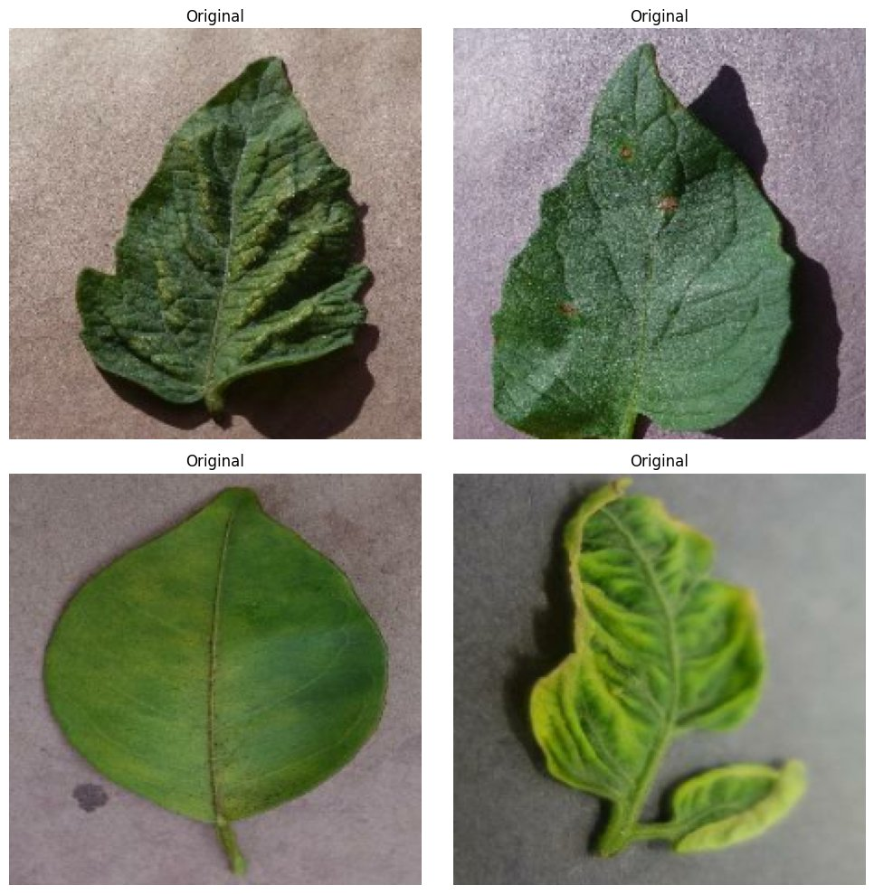
  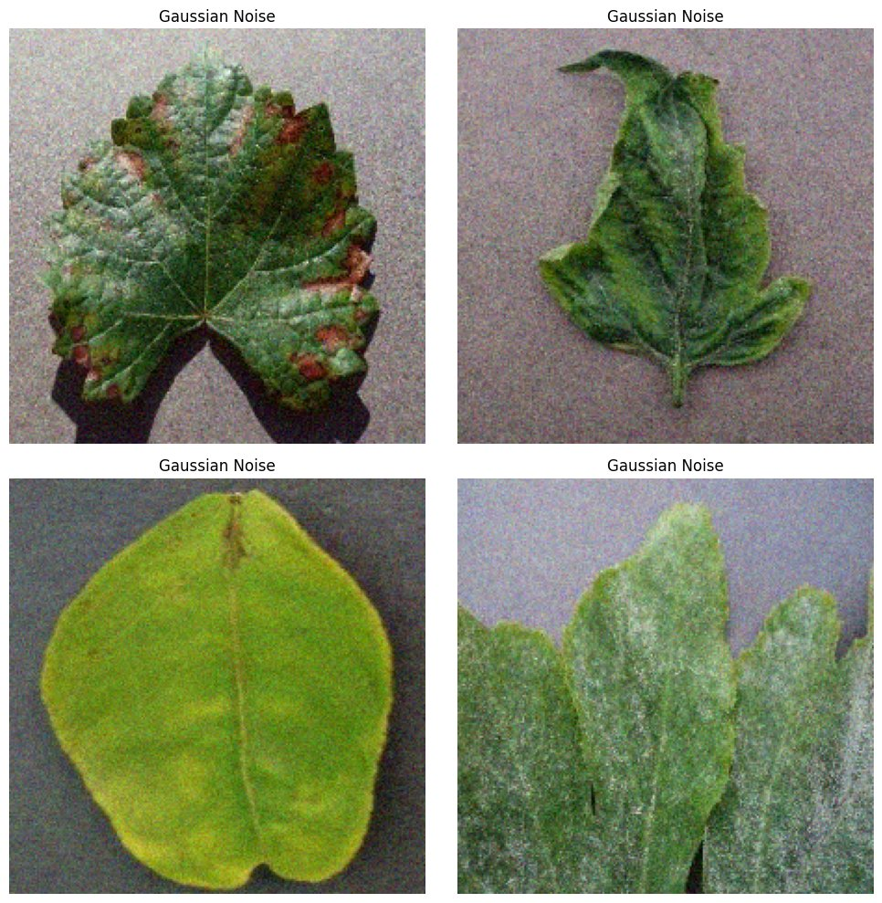
  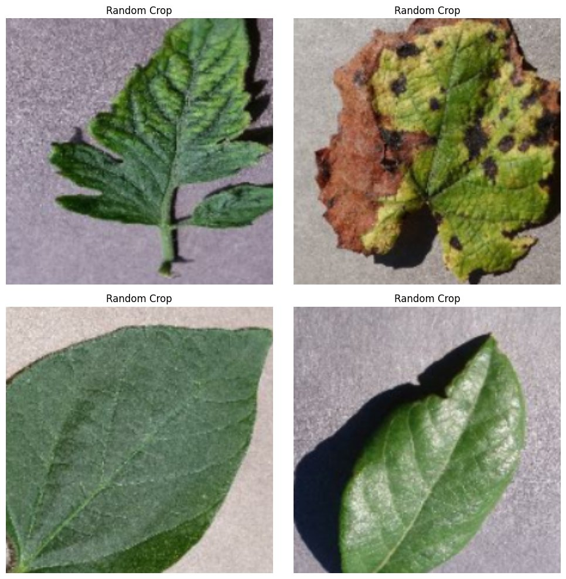
  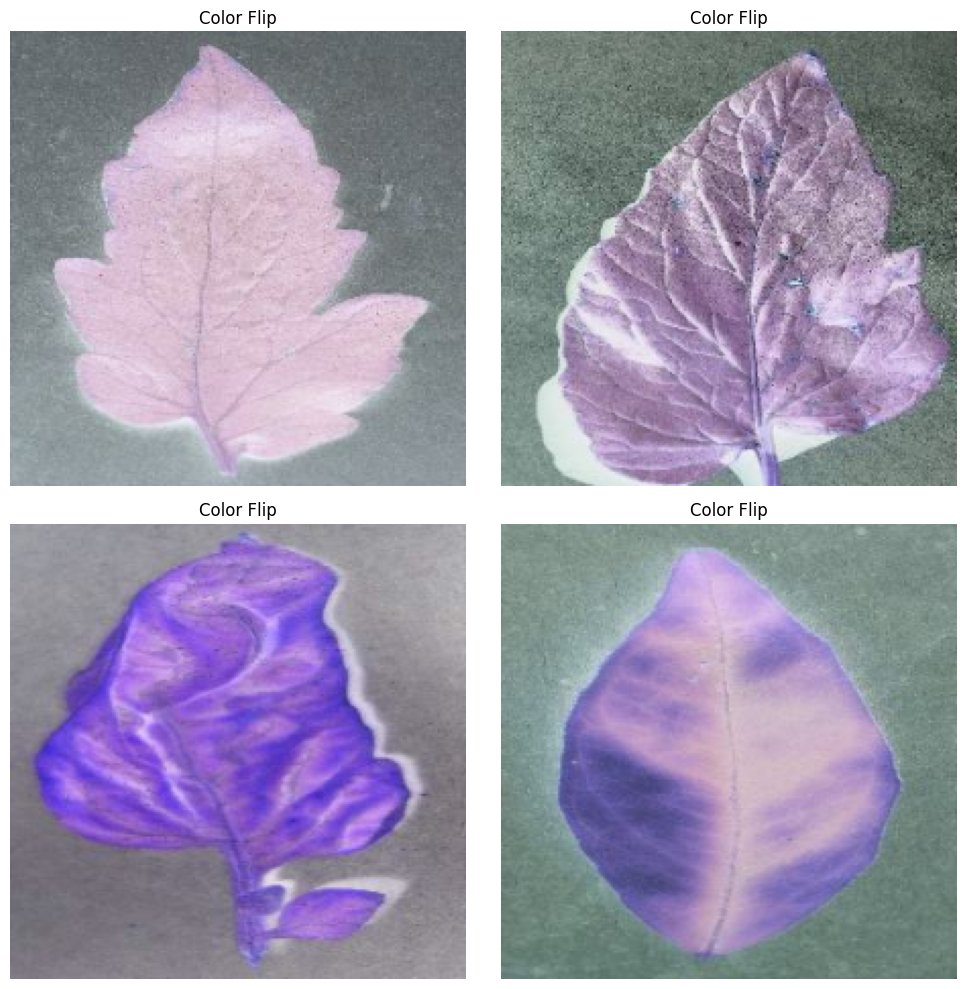
  <br><em>Original · Gaussian noise · Random crop · Colour flip</em>
</p>

<p align="center">
  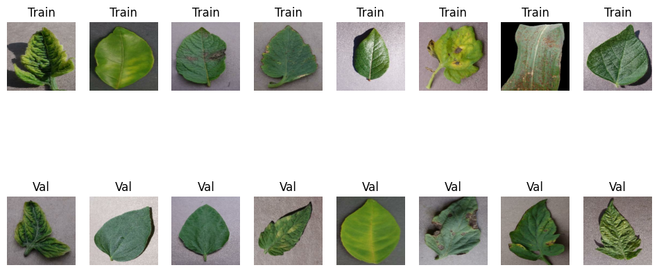
  <br><em>Training images (augmented, top) vs validation images (clean, bottom)</em>
</p>

---

## 🤖 Models Used

### 1. 🧠 Custom CNN (trained from scratch)

A compact convolutional network with three convolution blocks. Batch Normalization stabilises training and Dropout fights overfitting.

```
Input (224×224×3) → Augmentation
→ Conv2D(32) → BatchNorm → MaxPool
→ Conv2D(64) → BatchNorm → MaxPool
→ Conv2D(128) → BatchNorm → MaxPool
→ GlobalAveragePooling → Dense(128, ReLU) → Dropout(0.5)
→ Dense(38, Softmax)
```

- **Optimizer:** Adam · **Loss:** sparse categorical cross-entropy · **Epochs:** 10 · **Batch size:** 64

### 2. 🏆 ResNet50 (transfer learning)

ResNet50 is a 50-layer residual network pre-trained on ImageNet (1.2 million images). We **freeze the pre-trained backbone** and train only a new classification head on top. The model reuses general visual features it has already learned, such as edges, textures and shapes, so it needs far less data and training time.

```
ResNet50 backbone (ImageNet weights, frozen)
→ GlobalAveragePooling → Dense(256, ReLU) → Dropout(0.5)
→ Dense(38, Softmax)
```

- **Optimizer:** Adam (learning rate 0.001) · **Loss:** sparse categorical cross-entropy · **Epochs:** 10

### 3. 🌲 Random Forest

An ensemble of decision trees that vote on the final class.

- `n_estimators = 100`, `max_depth = None`, `random_state = 42` · input: 100 PCA features

### 4. ⚡ AdaBoost

Boosting builds many weak learners one after another. Each new learner focuses on the examples the previous ones got wrong.

- Base learner: decision stump (`max_depth = 1`) · `n_estimators = 50` · `learning_rate = 1.0` · input: 100 PCA features

### 5. 📍 K-Nearest Neighbors (KNN)

Classifies a leaf by looking at the 5 most similar training images and taking a majority vote.

- `n_neighbors = 5` · `metric = euclidean` · input: 100 PCA features

---

## 📈 Performance Comparison

| Rank | Model | Type | Train | Validation | **Test** |
|:---:|---|---|:---:|:---:|:---:|
| 🥇 | **ResNet50** | Deep learning (transfer) | 99.26% | 97.88% | **98.22%** |
| 🥈 | **Custom CNN** | Deep learning (scratch) | 92.10% | 80.79% | **81.45%** |
| 🥉 | **KNN** | Classic ML | 78.14% | 67.86% | **67.52%** |
| 4 | **Random Forest** | Classic ML | 100.00% | 67.43% | **66.82%** |
| 5 | **AdaBoost** | Classic ML | 24.31% | 24.31% | **24.11%** |

**Custom CNN, detailed test metrics (weighted average):** Accuracy 0.81 · Precision 0.86 · Recall 0.81 · F1-score 0.82

<p align="center">
  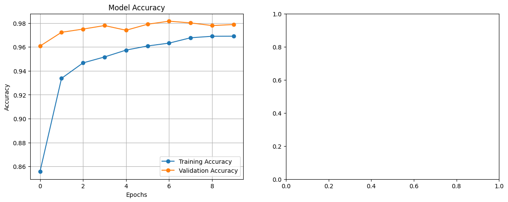
  <br><em>ResNet50 training history: accuracy and loss stay close for training and validation, a sign of good generalisation</em>
</p>

### 🖼️ More output figures

<p align="center">
  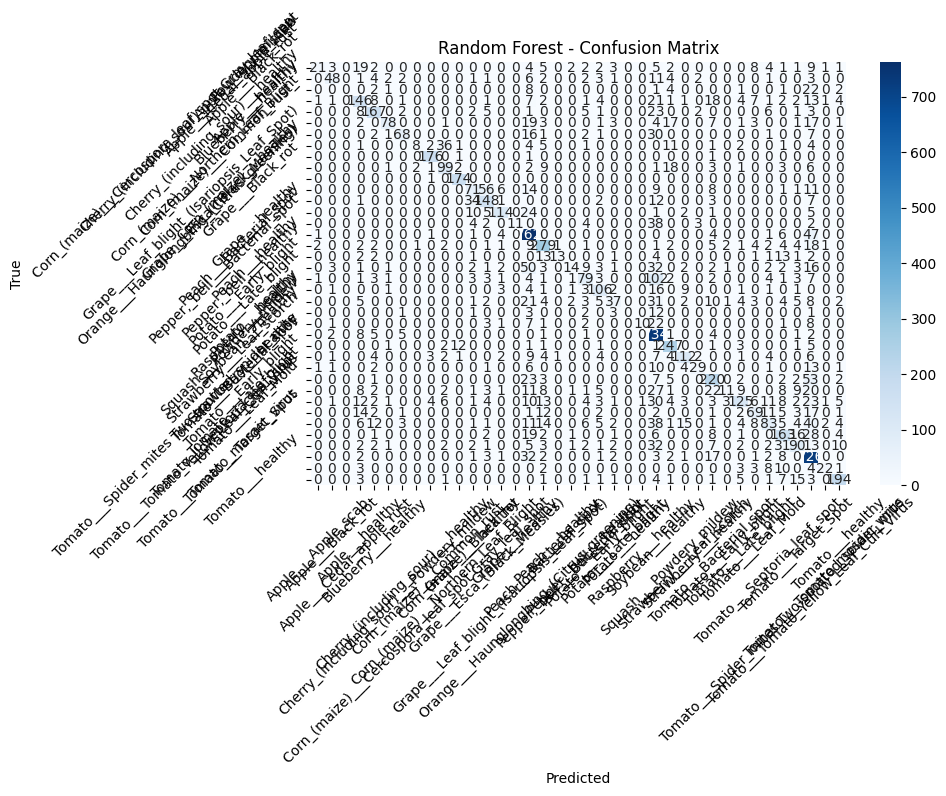
  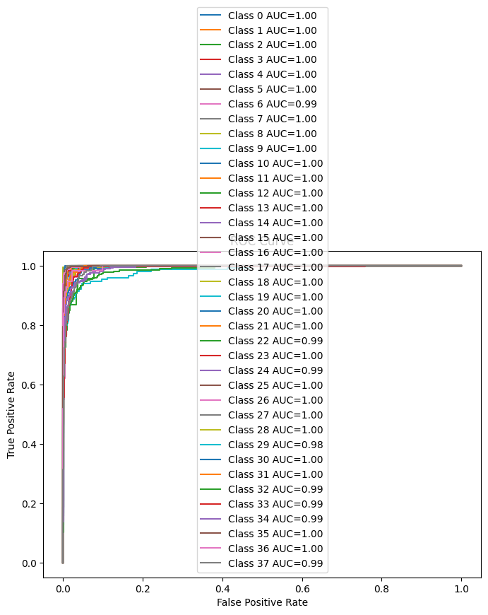
  <br><em>Random Forest confusion matrix (38 classes) · CNN ROC curves per class</em>
</p>

<p align="center">
  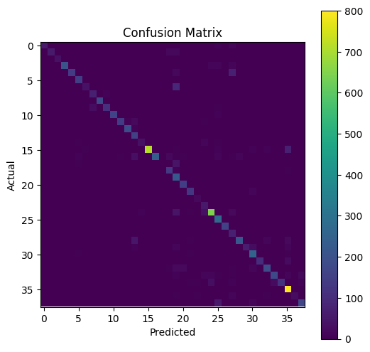
  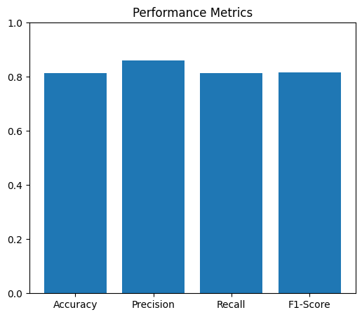
  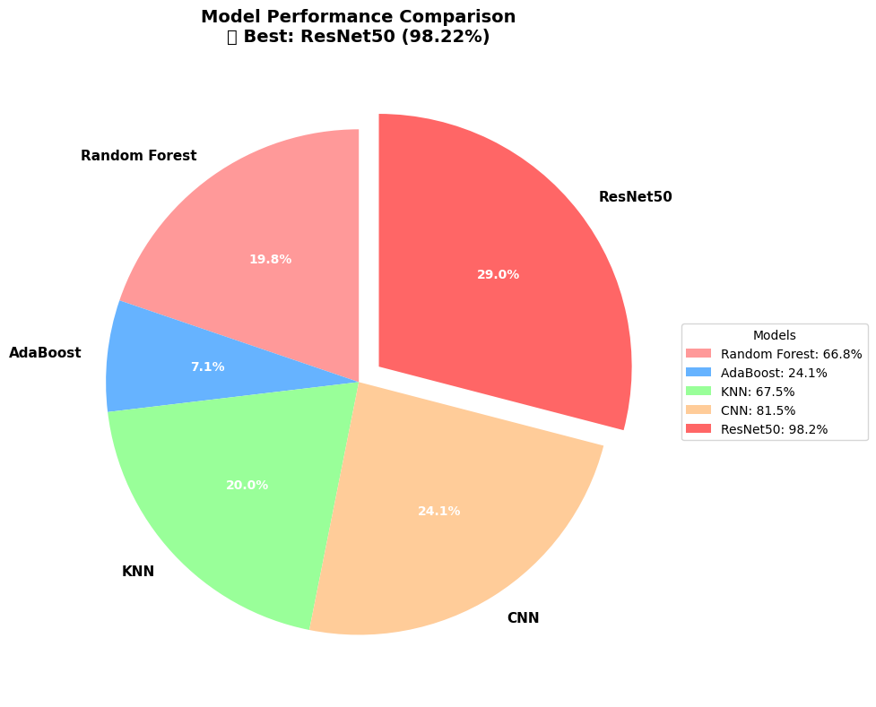
  <br><em>CNN confusion matrix · CNN performance metrics · Model performance share</em>
</p>

---

## 💡 Discussion

**🏆 Why ResNet50 won.** Transfer learning gives ResNet50 a huge head start: it already knows how to detect textures, spots, edges and colour patterns from ImageNet. Disease symptoms such as lesions, mould and discolouration are exactly those kinds of features. Its training (99.26%), validation (97.88%) and test (98.22%) scores are very close together, so it generalises well instead of memorising.

**🧠 The custom CNN is solid but limited.** Learning everything from scratch in 10 epochs on 38 classes is hard. It reaches 92% on training data but about 81% on test data, a small gap that more epochs, a deeper network or learning-rate scheduling could reduce.

**🌲 Random Forest overfits.** It scores a perfect 100% on training data but only 66.82% on test data. With unlimited tree depth, it memorises the training set.

**📍 KNN is simple but limited by its features.** At 67.52% it performs on par with Random Forest. Euclidean distance between PCA-compressed pixels is a weak measure of whether two leaves have the same disease.

**⚡ AdaBoost struggles.** Decision stumps are too weak to separate 38 visually similar classes, so it reaches only about 24%.

> **Key takeaway:** For image-based plant disease detection, **deep learning with transfer learning clearly beats traditional ML**. Hand-crafted or compressed pixel features lose the spatial patterns that make diseases recognisable, while CNNs learn those patterns directly.

### 🔭 Future work

- Fine-tune the top layers of ResNet50 for even higher accuracy
- Try lighter models (MobileNet, EfficientNet) that can run on a farmer's phone
- Test on real field photos with complex backgrounds, not just lab images
- Add explainability (Grad-CAM) to show *where* on the leaf the model sees the disease

---

## 🚀 How to Run

1. **Download the dataset:** [PlantVillage on Kaggle](https://www.kaggle.com/datasets/mohitsingh1804/plantvillage)
2. **Install dependencies:**
   ```bash
   pip install tensorflow scikit-learn numpy matplotlib seaborn
   ```
3. **Open the notebook** `CSE427 project (8).ipynb` and update the dataset paths in the first cells (`base_path`, `merged_path`, `dataset_path`) to point to your copy.
4. **Run the cells in order:** merge → split → preprocess → train each model → evaluate.

> 💻 A GPU is strongly recommended. Each deep-learning epoch takes about 12 minutes on an RTX 3070 Ti.

**View the website locally:** open `website/index.html` in any browser.
**Redeploy the website to Vercel:** run `.\deploy.ps1` from the repo root.

---

## 📁 Repository Structure

```
Plant-Disease-Detection/
├── CSE427 project (8).ipynb   # Full notebook: preprocessing, training, evaluation
├── README.md                  # You are here
├── deploy.ps1                 # One-command deploy of the website to Vercel
└── website/                   # Live project website (static HTML, no build step)
    ├── index.html
    ├── paper.pdf              # Research paper
    └── images/                # Output figures extracted from the notebook
```

---

## 🧠 Research Paper

<div align="center">

### **A Comparative Study of Plant Disease Detection Using Machine Learning**

📄 [**Read the paper (PDF)**](website/paper.pdf) · 🌐 [**View the website**](https://plant-disease-detection-dusky.vercel.app)

| 👤 Authors |
|:---:|
| **Khandoker Md. Ragib Ahsan** |
| **Asif Al Mahfuz** |
| **Anika Afrin** |

🏛️ Department of Computer Science and Engineering<br>
**BRAC University**, Dhaka, Bangladesh

<br>

⭐ *If you found this project useful, consider giving it a star!*

</div>
